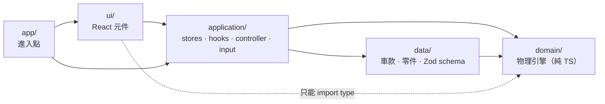
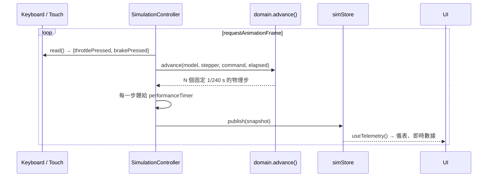

# 架構

## 分層與依賴方向

依賴只能由外往內。Domain 不認識任何其他層。



| 層            | 可依賴                                     | 禁止                                              |
| ------------- | ------------------------------------------ | ------------------------------------------------- |
| `domain`      | 只有 `domain`                              | React、DOM、Zustand、Zod、`window`、`setInterval` |
| `data`        | `domain`（型別）                           | `application`、`ui`                               |
| `application` | `domain`、`data`                           | `ui`                                              |
| `ui`          | `application`；`domain` 僅限 `import type` | `data`、`domain` 的執行期程式                     |

### 強制機制

1. **ESLint**（[eslint.config.js](../eslint.config.js)）：`@typescript-eslint/no-restricted-imports` 依資料夾設定禁止的 import 路徑，同時涵蓋 `@/` 別名與相對路徑；UI 對 domain 用 `allowTypeImports`。
2. **Domain 專用 tsconfig**（[tsconfig.domain.json](../tsconfig.domain.json)）：`lib: ["ES2022"]`、`types: []`，domain 用到 `window` / `document` 會直接編譯失敗。
3. 其他全域規則：禁止 `any`、`@ts-ignore`、`setInterval`，單檔上限 300 行。

## 資料流



- **設定變更**：`configStore`（車款 id + `TuneSelection`）→ `useSimConfig()` 用 `resolveTune()` 轉成 domain 的 `TuneSetup` → `controller.setConfig()` 重建 `SimModel`，物理狀態不中斷。換車款才會重置。
- **馬力機**：`dynoService.computeDyno(config)` 跑引擎掃描 + 全油門底盤測試（約 2 萬個物理步，數毫秒），結果以設定為 key 快取。

## 直線加速賽

```
domain/race/      tree（燈樹時序）· racer（起步/終點偵測）· opponent（AI 騎士）· race（狀態機 + 雙車固定步長）· result（勝負）
application/race/ RaceController（擁有兩台車的模型與比賽狀態）· opponentSetup（改裝等級 → 零件選擇）
ui/race/          RaceScene + scene/*（Three.js，命令式）· RaceHud · RaceSetupPanel · RaceResultCard
```

- 比賽狀態機：`staged → countdown → racing → finished`。兩台車共用一個比賽時鐘，同一個 1/240 秒步長一起前進，所以結果與畫面幀率無關。
- 隨機性（燈樹延遲、對手反應誤差）由 application 層注入，domain 保持可重現，方便測試。
- 3D 場景每一幀直接從 `raceStore` 讀最新狀態並自行渲染，不經過 React 重新渲染。
- 同一時間只掛載一種模式（模擬器或比賽），所以只有一個控制器在接鍵盤和動畫迴圈。

## 主要概念

| 名稱               | 所在層      | 說明                                                                                                                               |
| ------------------ | ----------- | ---------------------------------------------------------------------------------------------------------------------------------- |
| `BikeSpec`         | domain      | `ScooterSpec`（含 `cvt`）或 `ManualSpec`（含 `gearbox`）的聯集，另有牌照 `licenseClass`；每區附 `Provenance`                       |
| `DrivetrainModel`  | domain      | CVT 或手排的模擬模型；[coupling.ts](../src/domain/simulation/coupling.ts) 把兩者統一換算成曲軸端的速比與離合器容量，求解器不用區分 |
| `TuneSetup`        | domain      | 模擬實際使用的數值；`cvt` 欄位在打檔車為 null                                                                                      |
| `PartSpec`         | data        | 零件型錄條目，以「相對原廠」表示（係數 / 偏移量）                                                                                  |
| `TuneSelection`    | application | 使用者的選擇（零件 id + 普利珠 + 體重），可序列化存成組合                                                                          |
| `SimModel`         | domain      | 由 `SimConfig` 預先計算好的模型，供 240 Hz 迴圈使用                                                                                |
| `InputSource`      | application | 輸入裝置抽象；鍵盤、觸控各一實作，由 `CompositeInputSource` 合併                                                                   |
| `PresetRepository` | application | 改裝組合存取介面；目前為 localStorage，可替換成 Capacitor Preferences 或後端                                                       |

## 為什麼這樣切

- **物理可單獨測試**：所有「改普利珠 → 換檔轉速變高」之類的性質測試在 Node 執行，不需瀏覽器。
- **新增車款零程式碼**：只要新增一個資料檔，見 [ADDING_A_BIKE.md](ADDING_A_BIKE.md)。
- **可移植**：domain 與 application 不依賴桌面 API，可用 Capacitor 包成 App；輸入層已支援觸控。
